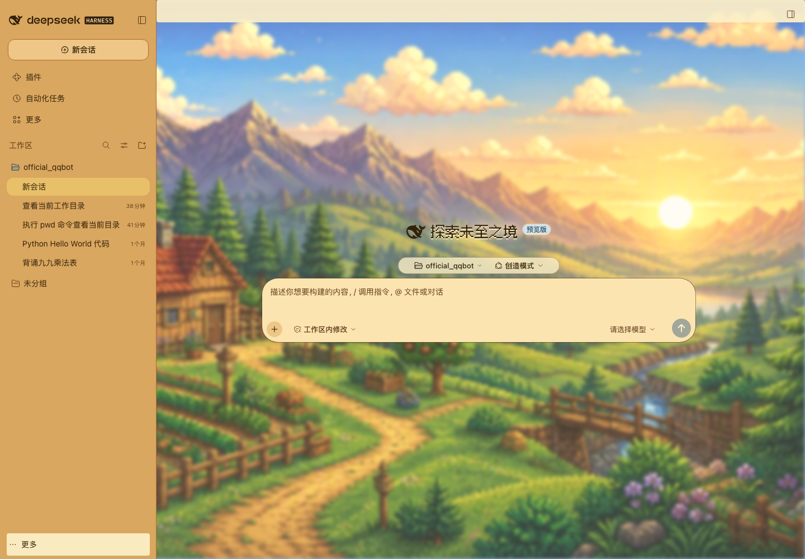
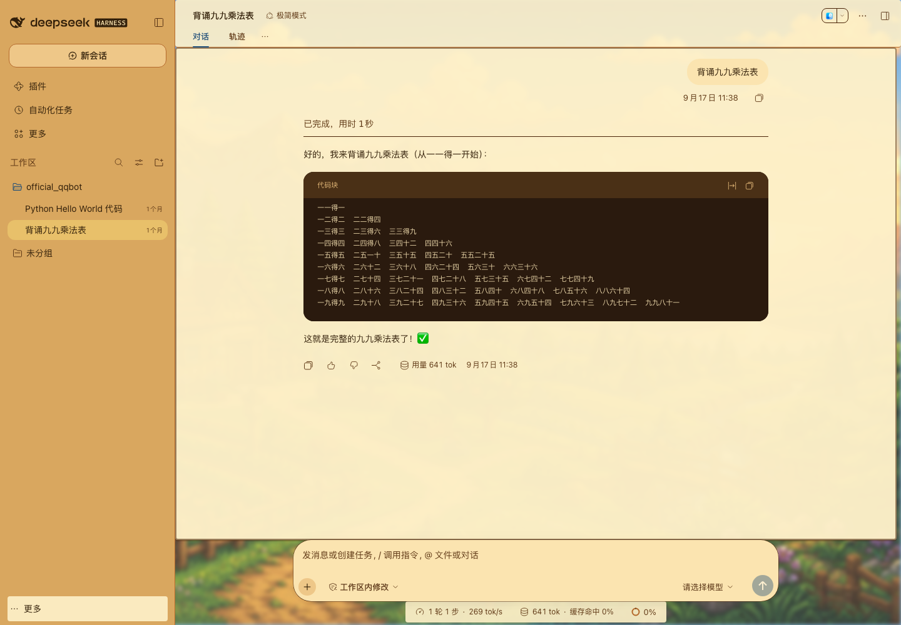
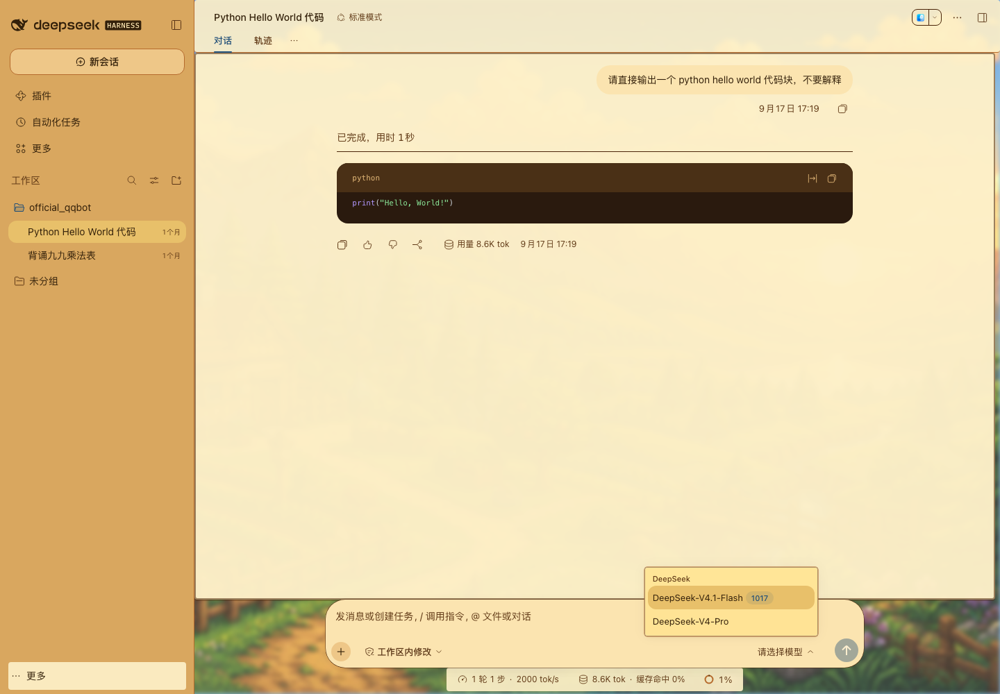
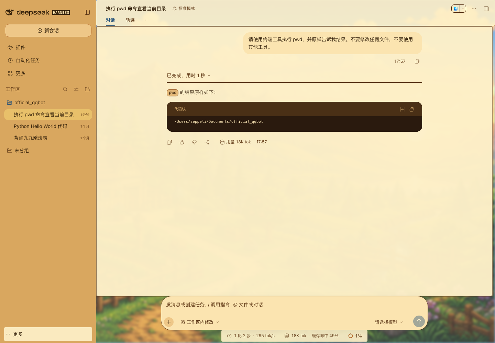
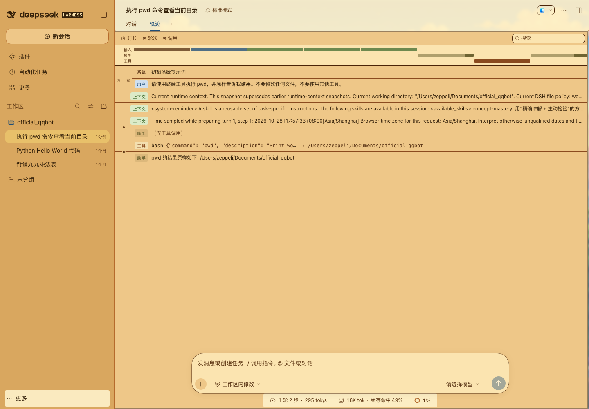
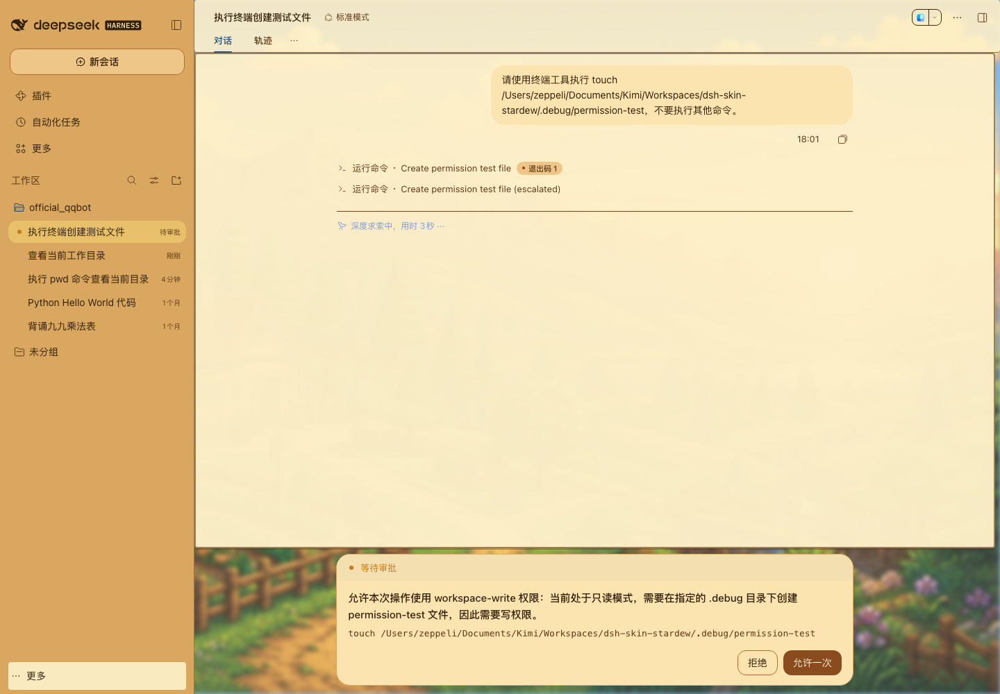

# dsh-theme-stardew-valley · 星露谷物语主题（组件化主题）

把 DeepSeek Harness 的 Web UI 刷成星露谷物语配色：展示标题使用像素字体，配合山谷壁纸、奶油色面板与木质按钮——**不替换官方前端**，官方 React UI 的每一项功能原样保留。

灵感来自 [dsh_theme_terraria](https://github.com/10086ggqq/dsh_theme_terraria)，但实现路线不同：本包走 dsh 官方客户端主题机制，以 `ctx.theme.overrideTokens()` 在当前主题上叠加一层星露谷 design-token（`--dsw-alias-*` / `--dsw-specific-*`），再加少量局部 CSS。


在 dsh 0.2.1-rc.3 上通过本地插件链接实测，走查覆盖首页、真实会话、Python 与纯文本代码块、工具调用与轨迹、模型与权限菜单，以及写入审批：














## 效果

- 展示性标题使用 Fusion Pixel（内嵌 woff2，中文友好）；正文、小字、快捷键与代码保留宿主排版
- 整个 App 背景换成星露谷风像素山谷（内嵌 JPEG，`--dsw-alias-bg-base: transparent` 透出）
- ~70 个 dsw token 覆盖：奶油纸面 `#fbe4b0`、深棕描边 `#4a2408`、木按钮 `#8a4b1f`、谷仓红 `#a8331c`、草绿 `#2a6b2d`
- 正文与辅助文字在浅色表面达到 4.5:1 对比度；首页标题使用柔和衬影，工作区入口采用紧凑胶囊
- 圆角统一压到 2px 的「像素面板」观感，选区色换成星露谷黄
- light / dark 两组 token 同值——星露谷没有黑夜模式 🌽

## 安装

```bash
# 环境：dsh CLI 0.1.2-rc.1 ~ 0.2.1-rc.3 实测兼容（dsh --version 确认；
# 主题走官方 overrideTokens 机制与 --dsw-* token，跨 0.1.x / 0.2.x 版本稳定）
dsh plugin --profile web add dsh-theme-stardew-valley  # 从 npm / 插件源
# 或本地目录：
dsh plugin --profile web add /path/to/dsh-stardew-skin
dsh web                                                # 重启后生效
```

打开页面如未变化，强制刷新 `Ctrl+F5` 或地址加 `?v=2` 绕过缓存。

**平台范围：** 当前 `dsh.client.platform` 仅声明 `web`，因此本包只接入 Web UI。Desktop 原生应用仍显示官方界面，不属于当前适配范围。

## 卸载

```bash
dsh plugin --profile web remove dsh-theme-stardew-valley
dsh web   # 重启后恢复官方默认外观
```

## 原理

```
dsh plugin add
  └─ package.json: dsh.client { platform: web, immediately, inject: [theme] }
  └─ cordis.patch.yml  → 向 bundle 插入 { id: stardew-theme }
       └─ lib/client.js（浏览器端）
            ├─ 注入 <style id="dsh-theme-stardew-valley">：@font-face + body 壁纸 + 局部标题样式
            └─ ctx.theme.overrideTokens('dsh-theme-stardew-valley', { '--dsw-alias-*': { light, dark }, ... })
```

主题层由官方 presenter 以 `body.style.setProperty()` 应用，跟随官方主题系统生命周期，升级 dsh 不丢。

## 开发

```bash
npm run build   # 把 assets/ 的字体+壁纸转 base64 填入 scripts/client.template.js → lib/client.js
npm test        # 文字对比度、字体作用域、生成产物同步与预览服务回归测试
npm run dev     # 在 http://127.0.0.1:7100/ 打开静态主题预览
```

改配色：编辑 `scripts/client.template.js` 里的 `PALETTE` 表后重新 build。预览命令支持 `npm run dev -- --host 127.0.0.1 --port 7100` 参数转发。

## 目录结构

```
├── package.json            <- 插件清单（dsh.client / dsh.bundle 声明）与开发命令
├── cordis.patch.yml        <- bundle 补丁：插入 stardew-theme 行
├── index.html              <- 加载真实生成主题的静态预览页
├── lib/
│   ├── index.js                宿主侧入口（no-op，占位产生 loader 条目）
│   └── client.js               浏览器端主题（由 scripts/build-client.mjs 生成）
├── scripts/
│   ├── client.template.js      client.js 模板（PALETTE 配色表在这里）
│   ├── build-client.mjs        资源内嵌构建脚本
│   └── dev-server.mjs          无依赖本地预览服务器
├── tests/                  <- Node 内置测试运行器回归测试
├── assets/                 <- 维基原始素材 + SOURCES.md 来源清单
└── screenshots/            <- 效果图
```

## 与整皮版怎么选

> 🔀 本仓库是**组件化主题**。完全替换版（祝尼魔对话、农场选模式、能量条 HUD、桌宠、8-bit 音效）已拆分为独立仓库 [`dsh-theme-stardew-fullskin`](https://github.com/Zeppeli777/dsh-theme-stardew-fullskin)：
> `dsh plugin --profile web add github:Zeppeli777/dsh-theme-stardew-fullskin`

| | **dsh-theme-stardew-valley**（本仓库） | [dsh-theme-stardew-fullskin](https://github.com/Zeppeli777/dsh-theme-stardew-fullskin)（整皮版） |
| --- | --- | --- |
| 机制 | 官方 token 覆盖 | 整体替换伺服的前端 |
| 官方新功能 | 自动跟随 | 需手动追版 |
| 兼容性 | dsh 0.1.2-rc.1 ~ 0.2.1-rc.3 实测通过 | 同左（0.1.5-rc.1 / 0.1.7-rc.2 / 0.2.1-rc.3 实测） |
| 稳定性 | 高（不碰 DOM 结构） | 依赖 RPC 协议细节 |
| 玩法 | 纯视觉 | 祝尼魔 / 桌宠 / 音效 / 能量条 |

## 素材来源与许可

- 代码：**MIT License**
- 游戏素材（Logo、祝尼魔、农场图标等）：取自 [Stardew Valley Wiki](https://zh.stardewvalleywiki.com)，版权归 ConcernedApe 所有。粉丝向非官方皮肤，**素材请勿商用**。逐文件来源见 `assets/SOURCES.md`。
- 像素字体 Fusion Pixel：遵循其自身开源许可（Fusion Pixel Font 项目）。
- 山谷壁纸 `assets/valley.jpg`：AI 生成的星露谷风格像素画。

愿祝尼魔的星光落在你的每一次编译上。
